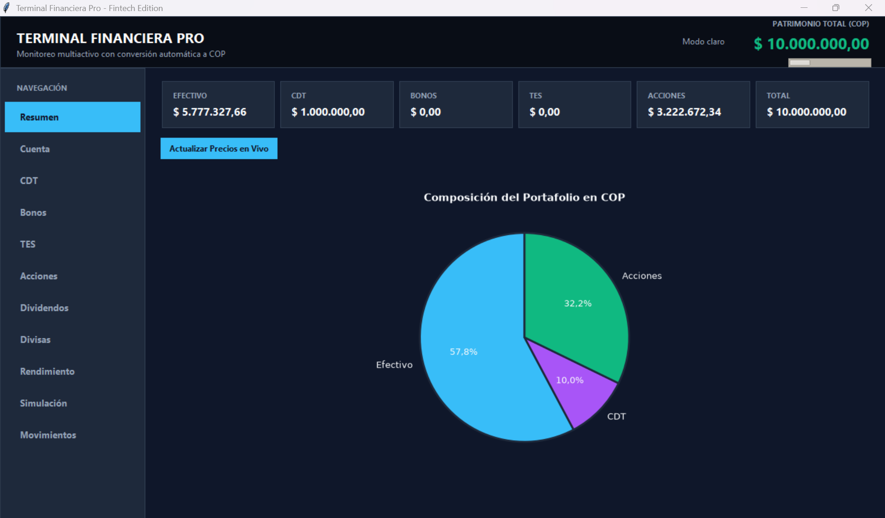
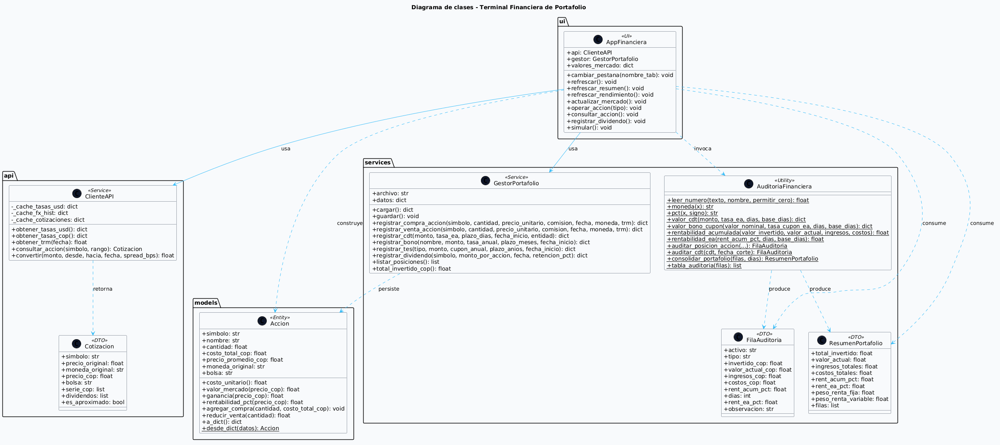

# Terminal Financiera Profesional de Portafolio

Aplicación de escritorio en Python para el seguimiento, monitorización y auditoría de portafolios de inversión multiactivos con conversión automática a pesos colombianos (COP).



## Descripción

Sistema académico que permite registrar y evaluar el desempeño de un portafolio compuesto por renta fija y renta variable:

- **Renta variable:** acciones internacionales y colombianas listadas en NYSE y NASDAQ (Coca-Cola, Nike, Apple, Microsoft, Ecopetrol, Bancolombia, entre otras), con conversión a COP usando TRM histórica.
- **Renta fija:** Certificados de Depósito a Término (CDT), bonos corporativos y Títulos de Deuda Pública (TES).
- **Ingresos:** dividendos con retención en la fuente del 4% para acciones, intereses de CDT con retención del 7% para rendimientos financieros.
- **Costos:** comisiones del bróker descontadas del resultado financiero.
- **Valoración:** precios de mercado en tiempo real con `yfinance` y tasas de cambio con `open.er-api`.
- **Auditoría:** cálculo de rentabilidad acumulada y rentabilidad efectiva anual (E.A.) por activo y consolidada.

## Funcionalidades

| Módulo | Descripción |
|--------|-------------|
| Resumen | Tarjetas con el patrimonio total y gráfica de composición del portafolio. |
| Cuenta | Depósitos y retiros de efectivo en COP. |
| CDT | Apertura con tasa E.A., plazo y liquidación con interés compuesto base 360. |
| Bonos | Compra y redención con cupón anual. |
| TES | Adquisición y redención con cupón anual. |
| Acciones | Consulta de precios en vivo, compra y venta con comisión de bróker, gráfico histórico en COP. |
| Dividendos | Registro con retención del 4%. |
| Divisas | Conversión multidivisa con tasas en tiempo real. |
| Rendimiento | Rentabilidad acumulada, rentabilidad E.A. por activo y consolidada. |
| Simulación | Simulador histórico de inversión en acciones. |
| Movimientos | Historial completo de operaciones. |

## Arquitectura

```
Proyecto-Finance/
├── main.py                          # Punto de entrada
├── requirements.txt                 # Dependencias
├── .gitignore
├── LICENSE
├── README.md
├── api/
│   └── cliente_api.py               # yfinance + open.er-api
├── models/
│   └── accion.py                    # Entidad Accion
├── services/
│   ├── gestor_portafolio.py         # Persistencia y registro de operaciones
│   └── auditoria_financiera.py      # Cálculos y formato
├── ui/
│   ├── componentes_graficos.py      # Paleta y estilos
│   ├── notificaciones.py            # Toasts flotantes
│   └── ventana_principal.py         # Interfaz Tkinter
└── docs/
    ├── capturas/
    │   ├── resumen.png
    │   └── uml.png
    └── uml/
        └── diagrama_clases.puml
```

## Requisitos

- Python 3.10 o superior
- Tkinter (incluido en la instalación estándar de Python en Windows y macOS)
- Conexión a internet para cotizaciones y tasas de cambio

## Instalación

```bash
git clone https://github.com/omarnieto2103/Proyecto-Finance.git
cd Proyecto-Finance
python -m venv venv
venv\Scripts\activate
pip install -r requirements.txt
```

## Ejecución

```bash
python main.py
```

La aplicación abre en modo oscuro con once pestañas navegables. El archivo `datos_portafolio.json` se crea automáticamente la primera vez.

## Uso rápido

1. En la pestaña **Cuenta**, depositar efectivo en COP.
2. En la pestaña **CDT**, abrir un certificado indicando monto, plazo y tasa E.A.
3. En la pestaña **Bonos** o **TES**, adquirir títulos de renta fija.
4. En la pestaña **Acciones**, seleccionar una empresa del catálogo, consultar el precio en vivo y comprar o vender indicando la comisión del bróker.
5. En la pestaña **Dividendos**, registrar los dividendos recibidos por las acciones en posición.
6. En la pestaña **Rendimiento**, revisar la rentabilidad acumulada y la rentabilidad E.A. por activo y del portafolio completo.
7. En la pestaña **Simulación**, probar una inversión histórica en cualquier acción del catálogo.

## Retenciones aplicadas

| Concepto | Retención |
|----------|-----------|
| Dividendos de acciones | 4% |
| Rendimientos financieros (CDT, bonos, TES) | 7% |

## Diagrama de clases



También disponible en formato PlantUML: [docs/uml/diagrama_clases.puml](docs/uml/diagrama_clases.puml).